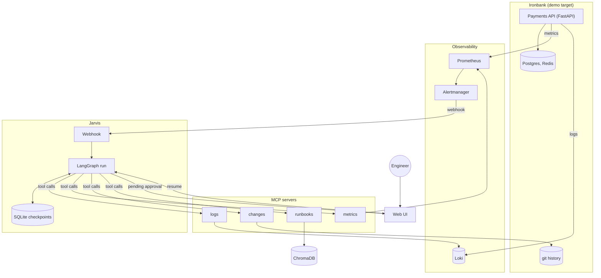
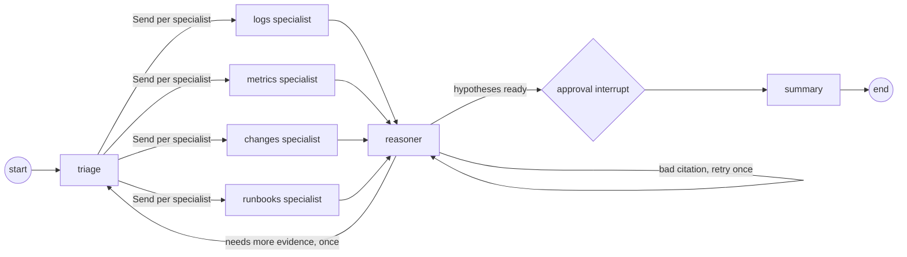
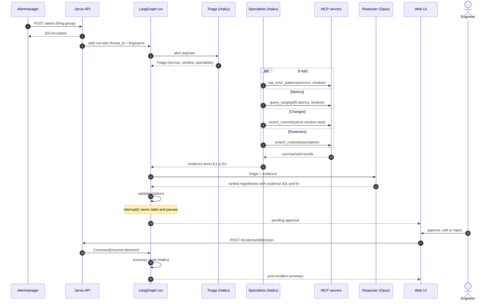
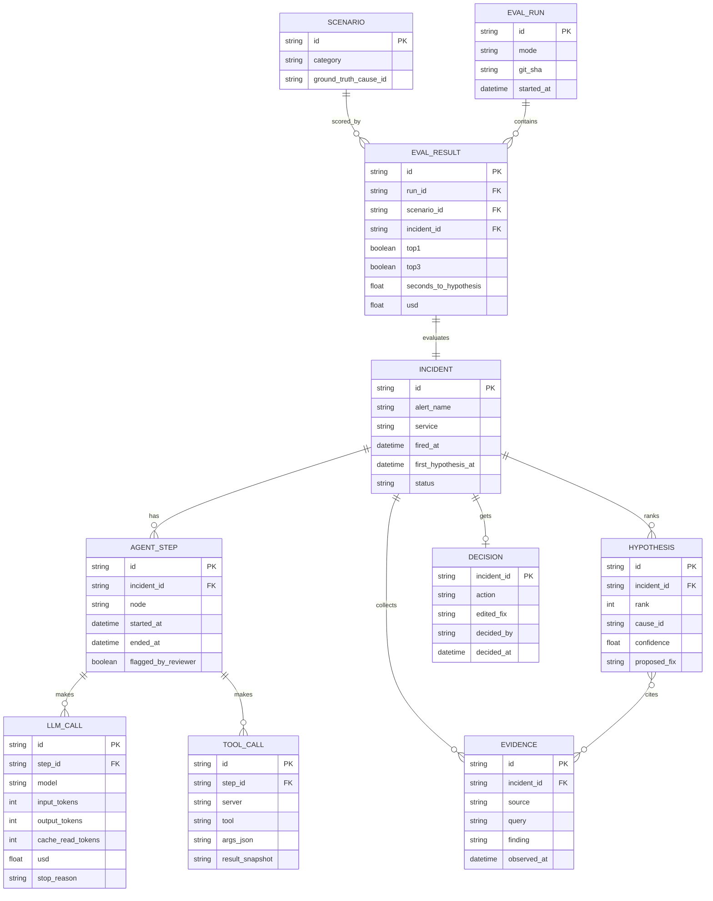
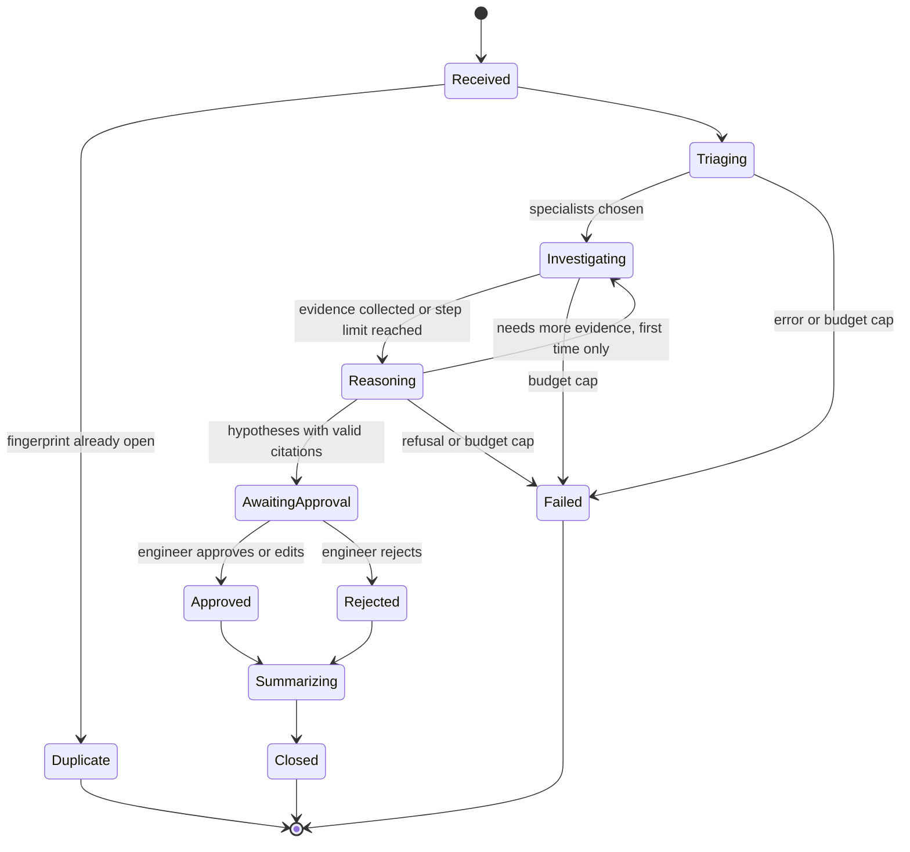
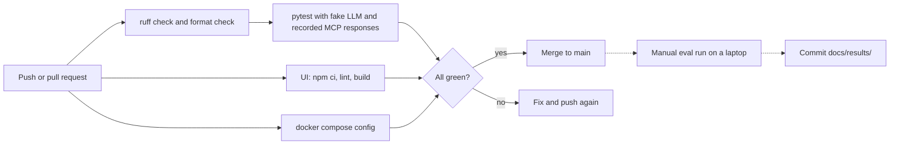
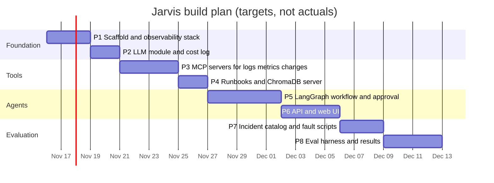

# Jarvis – Incident Agents: interview prep

Companion to [README.md](README.md). This file is for explaining the project out loud: the pitch, how each tool works, the diagrams, and the questions interviewers ask. Nothing here is a measured result. Every `[measured ...]` blank gets filled from `docs/results/` after the eval runs.

---

## At a glance

### 30-second pitch

"Jarvis is a multi-agent system that does the first pass of incident response. When a Prometheus alert fires, a LangGraph workflow starts: a triage agent reads the alert, four specialist agents pull evidence from logs, metrics, git history and runbooks through MCP tool servers, and a reasoning agent on Claude Opus ranks the likely root causes, with every claim tied to a piece of evidence. Then it stops and waits for a human to approve the fix. I test it by breaking my own payments service, Ironbank, in 15 to 20 scripted ways and scoring whether Jarvis finds the real cause in its top one or top three, how long it takes, and what it costs per incident."

### 2-minute walkthrough

"The problem is the first 20 minutes of an incident. The on-call engineer does the same things every time: look at the dashboard, query logs, check what was deployed, find the runbook. I wanted to see how much of that an agent system can do reliably, and to measure it instead of guessing.

The setup is all in Docker Compose. Ironbank, my payments API with Postgres and Redis, runs next to Prometheus, Alertmanager, Loki and Grafana. Alert rules on error rate and latency fire through Alertmanager to a FastAPI webhook in Jarvis.

Each incident is one LangGraph run. The first node is triage, on Claude Haiku: it turns the alert JSON into a typed object with the service, the time window and which specialists to run. Then the specialists run in parallel. Each one is a small tool-use loop on Haiku with a cap of six tool calls, and its tools come from an MCP server. I have four servers: Loki for logs, Prometheus for metrics, git for recent commits and config diffs, and ChromaDB for runbook search. The tools are read-only and they summarize on the server side, so the model gets grouped error patterns with counts, not thousands of raw lines.

Every piece of evidence gets an ID. The reasoning node runs on Claude Opus and returns structured output: up to three hypotheses, each with a cause from a fixed taxonomy, a confidence, the evidence IDs it relies on, and a proposed fix. My code checks the citations, and if one points at nothing, the model has to fix it.

Then the graph hits a LangGraph interrupt. State is checkpointed in SQLite, and the web UI shows the timeline and the proposed fix. When I approve or reject, the API resumes the graph and a summary agent writes the post-incident report.

For evaluation I wrote 15 to 20 fault scripts: kill a container, drop an index, set a bad config value, squeeze memory, deploy a bad commit. Each has a ground-truth cause ID, so scoring is exact match, top-1 and top-3. I also save every tool response as a snapshot, so I can re-run just the reasoning step after a prompt change without breaking the stack again. That matters because my whole API budget is about 100 dollars. The results are [measured top-1], [measured top-3], [measured median time] to first hypothesis and [measured USD] per incident."

---

## Tech stack deep dive

| Tool | What it does here | Why this and not the alternative |
|---|---|---|
| LangGraph | Runs the incident workflow as a graph: triage, parallel specialists, reasoning, approval, summary | Why not a plain Python loop: I would have to build checkpointing, parallel fan-out and pause/resume myself. Why not CrewAI or AutoGen: they hide the control flow, and I want each edge explicit and testable |
| MCP Python SDK | Four tool servers (logs, metrics, changes, runbooks) that the agents call | Why not plain Python functions: MCP gives a process boundary and a standard schema, so the same tools work from Claude Desktop, Claude Code or another agent, and they are tested on their own |
| Claude via `anthropic` SDK | Haiku 5.5 for triage, specialists and summary; Opus 5.5 for root-cause reasoning | Why not one model for everything: most calls are simple tool loops where Haiku is far cheaper; the one hard judgment call gets Opus. Why the raw SDK and not LangChain's chat wrappers: I see the exact request, usage fields and `stop_reason` |
| ChromaDB | Stores runbook chunks with metadata and serves similarity search | Why not pgvector or Pinecone: a dozen runbooks do not need a server or a paid service; Chroma runs embedded in the runbooks MCP server |
| Prometheus + Alertmanager | Scrapes Ironbank, Postgres, Redis and container metrics; alert rules fire webhooks | Why not Datadog or CloudWatch: free, local, and PromQL is what most SRE teams use |
| Loki + Grafana Alloy | Alloy ships Docker container logs to Loki; the logs server queries with LogQL | Why not Elasticsearch: Loki indexes only labels, so it is light enough for a laptop, and it pairs with Grafana |
| Grafana | Dashboards for checking Jarvis's claims by hand | Needed to verify the evidence the agents cite |
| FastAPI | Alert webhook, incident API, approval resume endpoint | Async, Pydantic models shared with the graph state, same framework as Ironbank |
| SQLite | Incidents, LangGraph checkpoints, cost log | Why not Postgres: single-writer local demo; the LangGraph checkpointer interface makes a later swap to Postgres small |
| Next.js + Tailwind | Incident list, timeline and approval UI, eval table | Why not Streamlit: I need a polished approval flow and full control over layout, and the unslop rules are written for React and Tailwind |
| Docker Compose | Brings up Ironbank, observability, MCP servers, Jarvis and the UI | Why not Kubernetes: one machine, one command; the fault scripts use `docker` commands directly |
| pytest + GitHub Actions | Unit tests, MCP server tests on recorded responses, graph tests with a fake LLM | Tests must not need an API key or spend money |

### Concepts you must know

**LangGraph**
- A `StateGraph` has a typed state (a `TypedDict` or Pydantic model), nodes that return partial state updates, and edges.
- Reducers decide how updates merge. A key like `evidence: Annotated[list[Evidence], operator.add]` lets parallel nodes append without overwriting each other. Without a reducer, two parallel writes to the same key raise an error.
- Parallel branches run in the same superstep. Dynamic fan-out uses conditional edges that return `Send("specialist", payload)` objects, one per specialist triage chose.
- A checkpointer (here `SqliteSaver`) saves state after each superstep, keyed by `thread_id`. That is what makes pause, resume and crash recovery possible.
- `interrupt(value)` pauses the run and surfaces `value` to the caller. Resuming with `Command(resume=decision)` re-runs the interrupted node from its start, and `interrupt()` returns the decision. Code before the `interrupt()` call must be safe to run twice.
- `recursion_limit` caps total steps and guards against loops.

**MCP (Model Context Protocol)**
- Three roles: host (the app), client (one connection per server), server (exposes capabilities).
- Servers expose tools (functions the model can call), resources (readable data) and prompts (templates). Jarvis uses tools.
- Messages are JSON-RPC 2.0. Transports are stdio (local subprocess) and streamable HTTP (network service). Jarvis uses streamable HTTP so each server is its own container.
- The client calls `list_tools` to get names, descriptions and JSON Schemas, then `call_tool` to run one. Jarvis converts each MCP tool schema into a Claude tool definition.
- Tool descriptions are prompts. A vague description causes wrong tool choices.

**Claude API (`anthropic` SDK)**
- Tool use loop: send `tools`, get `stop_reason == "tool_use"` with `tool_use` blocks, run them, send `tool_result` blocks back in one user message, repeat until `end_turn`.
- Claude can ask for several tools in one turn. All results go back together in a single message. A failed tool returns a `tool_result` with `is_error: true` instead of being dropped.
- Always check `stop_reason` before reading content: `end_turn`, `tool_use`, `max_tokens` (truncated), `refusal` (declined; `stop_details` says why), `pause_turn`.
- Structured outputs: `client.messages.parse()` with a Pydantic model, or `output_config.format` with a JSON Schema, makes the response match the schema. On Opus 5.5, forced `tool_choice` (`any` or a named tool) returns a 400, so structured outputs are the way to get guaranteed JSON.
- Effort (`output_config.effort`) trades depth for tokens. Opus 5.5 defaults to `medium` and its thinking cannot be turned off, so Jarvis sets effort explicitly per node.
- Prompt caching is a prefix match over `tools`, then `system`, then `messages`. Stable content goes first; one changed byte invalidates everything after it. Check `usage.cache_read_input_tokens` to confirm hits. Prefixes below a model-dependent minimum length are not cached.
- `usage` reports `input_tokens`, `output_tokens`, `cache_creation_input_tokens` and `cache_read_input_tokens`. The cost log multiplies these by a price table kept in config.
- Message Batches run requests asynchronously at half price, with results keyed by `custom_id` in any order.

**ChromaDB and RAG**
- A collection stores ids, documents, embeddings and metadata. Querying embeds the query and returns nearest neighbors.
- The default embedding function runs a small sentence-transformer model locally through ONNX, so there is no API cost.
- Chunking by markdown heading keeps each chunk about one failure mode, which retrieves better than fixed-size chunks for short runbooks.
- `where` filters on metadata (for example `{"service": "payments-api"}`) narrow the search before similarity ranking.
- Retrieval quality is measured separately from the agent, with a small set of questions and their expected runbook (hit rate at k).

**Prometheus and Alertmanager**
- Pull model: Prometheus scrapes `/metrics` endpoints on an interval.
- Metric types: counter (only goes up, use `rate()`), gauge (goes up and down), histogram (buckets, use `histogram_quantile()` for p95).
- `rate(http_requests_total{status=~"5.."}[5m])` is the per-second 5xx rate averaged over 5 minutes.
- Alert rules have a `for:` duration so a brief spike does not fire. Alertmanager groups, deduplicates, silences and routes alerts, and each group has a fingerprint.
- Label cardinality: every unique label combination is a new time series. Never put user IDs or request IDs in labels.
- cAdvisor exposes container CPU, memory and restart metrics; exporters expose Postgres and Redis internals.

**Loki and LogQL**
- Loki indexes only labels (container, service, level), not log text. Queries pick streams by label, then filter lines.
- `{service="payments-api"} |= "error" | json | status >= 500` is a stream selector, a line filter, a parser and a label filter.
- Metric queries such as `sum by (pattern) (count_over_time(...[5m]))` turn logs into counts, which is how `top_error_patterns` stays small.
- High-cardinality labels hurt Loki the same way they hurt Prometheus.

**Docker Compose**
- `healthcheck` plus `depends_on: condition: service_healthy` controls start order.
- `mem_limit` and `restart: "no"` are how memory-pressure and crash scenarios are created.
- `include:` pulls Ironbank's compose file into the Jarvis stack.

**FastAPI**
- The webhook returns `202 Accepted` right away and starts the graph run in the background; Alertmanager should never wait on an LLM.
- Pydantic models validate the Alertmanager payload and are shared with the graph state types.

**Next.js and Tailwind**
- The UI is a client of the Jarvis API; it polls the incident endpoint every few seconds while a run is active.
- Tailwind's spacing scale is on a 4px grid, which matches the unslop spacing rule.

**pytest and GitHub Actions**
- The fake LLM provider returns scripted responses, so graph tests check routing, reducers, citation checks and interrupt/resume without network calls.
- MCP server tests use recorded Loki and Prometheus responses as fixtures.
- CI runs ruff, pytest, the UI build and `docker compose config`. The live eval never runs in CI because it costs money and needs the full stack.

---

## Charts and workflows

### 1. System flowchart

Ironbank emits metrics and logs, an alert starts a LangGraph run, specialists gather evidence through MCP, and a human approves the proposed fix.

### 2. The LangGraph graph

Triage fans out to the chosen specialists, the reasoner may loop back once for more evidence, and the approval node pauses the run.

### 3. Sequence of one incident

One alert from firing to summary. The specialists run in parallel, and the run is paused while the engineer decides.

### 4. Data model

What the SQLite store keeps. Hypotheses cite evidence many-to-many, and eval results link a scenario to the incident it produced.

### 5. Incident lifecycle

The states one incident moves through. Failed covers errors, refusals and budget caps.

### 6. CI/CD workflow

Every push runs lint, tests with the fake LLM, the UI build and a compose check. The live eval is run by hand because it costs money.

### 7. Build plan

Plan only, not actuals. Dates are targets for about four weeks of work.

---

## Interview questions with answers

### Project overview

**1. What is Jarvis, in one or two sentences?**
It is a LangGraph multi-agent system that does the first pass of incident investigation. When an alert fires it gathers evidence from logs, metrics, git and runbooks through MCP tools, ranks likely root causes with citations, proposes a fix and waits for a human to approve it.

**2. Why multiple agents instead of one agent with every tool?**
One agent with 10+ tools and a long transcript tends to pick tools poorly and mixes up sources. Splitting by data source keeps each specialist's prompt and tool list small, lets them run in parallel, and lets me use a cheap model for that work. The reasoning agent then sees clean, numbered evidence instead of raw tool transcripts. The cost is more orchestration code, which LangGraph keeps explicit.

**3. How do you test it? You cannot wait for real outages.**
I break Ironbank on purpose. Each of 15–20 scenarios has an inject script (kill a container, drop an index, bad env var, low memory limit, bad commit), a reset script and a ground-truth cause ID. The harness runs them one by one and scores top-1 and top-3 accuracy, time to first hypothesis, and tokens and USD per incident.

**4. What did you write yourself and what is off the shelf?**
Off the shelf: LangGraph, the MCP SDK, the observability stack, ChromaDB. I wrote the graph and its nodes, the four MCP servers and their summarizing logic, the citation validator, the LLM module with cost logging and budget caps, the fault scripts, the eval harness with replay, and the UI.

**5. What is the result?**
Top-1 accuracy is [measured top-1] and top-3 is [measured top-3] over [N] scenarios, with a median of [measured seconds] to first hypothesis and [measured USD] per incident. The raw run output is in `docs/results/`. The scenarios it gets wrong are [fill in from results], and the main reason is [fill in].

### Design decisions and trade-offs

**6. Why LangGraph and not a hand-written loop, CrewAI or AutoGen?**
I needed three things: parallel branches with safe state merging, a checkpointer so a run can pause for a human and survive a restart, and explicit control flow I can unit test. LangGraph gives all three with reducers, `SqliteSaver` and `interrupt`. CrewAI and AutoGen are more conversational and hide the routing, which makes it harder to say exactly why the system did something.

**7. Why MCP instead of just calling Python functions?**
MCP gives each data source a process boundary and a standard schema. I can test the Loki server on its own, restart it without restarting the agents, and use the same tools from Claude Desktop when I debug by hand. The trade-off is network hops and a bit more setup; for read-only tools with second-level latency that cost is small.

**8. Why Haiku for evidence and Opus for reasoning?**
Evidence gathering is many small calls: pick a query, read a summary, write an evidence item. Haiku handles that well at a fraction of Opus's price. The final ranking is one call where a wrong answer costs the most, so it gets Opus. I can test this choice by running the reasoning step on Haiku in replay mode and comparing accuracy and cost: [measured comparison].

**9. How do you stop the reasoning agent from making up a root cause?**
Three layers. Every hypothesis must cite evidence IDs, and code checks they exist; a bad citation gets one retry and then the hypothesis is dropped. The cause must come from a fixed taxonomy or be marked `other`. And a human approves before anything happens, with the cited evidence shown next to each claim so it is quick to check.

**10. Why a fixed cause taxonomy? Is that cheating?**
It makes scoring exact and cheap: compare two strings, no LLM judge needed. The downside is that it narrows the answer space and could inflate accuracy compared with open-ended diagnosis. I keep an `other` option with free text, report how often it is used, and the taxonomy includes causes that no scenario uses, so the model cannot win by elimination.

**11. Why human approval, and how does it work technically?**
A wrong fix in production is worse than a slow one, and trust in an agent has to be earned with a track record. The approval node calls `interrupt()` with the hypotheses. LangGraph checkpoints state to SQLite and returns. When the engineer decides, the API calls the graph with `Command(resume=decision)` on the same `thread_id`, the node re-runs, `interrupt()` returns the decision, and the graph continues to the summary.

**12. What are evidence snapshots and why do you need them?**
During a live eval run, every MCP tool call and response is saved. Replay mode serves those saved responses instead of calling the real tools. That makes runs reproducible (live metrics differ slightly every time) and cheap, because I can change the reasoning prompt and re-score without breaking Ironbank again or paying for evidence gathering. The limit is that replay cannot test a specialist that would ask for a different query.

**13. How do you keep cost under control on a 100-dollar budget?**
Haiku for bulk steps; tool output summarized on the server so prompts stay small; system prompts and tool definitions first in each request with cache breakpoints; a six-call step limit per specialist; a per-incident and monthly budget cap in the LLM module; replay mode for prompt iteration; and a small eval set. Every call logs tokens and USD, so I know where money goes.

**14. Why Next.js and not Streamlit for the UI?**
Streamlit would be faster for a first version, but the approval page needs a clear timeline, a side-by-side view of hypotheses and their evidence, and careful copy. The unslop design rules I follow are written for React and Tailwind. The UI is small, three screens, so the extra setup is manageable.

### Deep dives per tool

**15. How does the parallel fan-out work in LangGraph, and what can go wrong?**
Triage returns the list of specialists. A conditional edge maps that list to `Send("specialist", {...})` objects, and LangGraph runs them in the same superstep. They all write to `evidence`, which is annotated with `operator.add` so the lists concatenate. Without the reducer you get an invalid concurrent update error. Evidence IDs must be unique across branches, so each specialist prefixes its IDs (for example `L1`, `M1`).

**16. What happens if the Jarvis process restarts while an incident is waiting for approval?**
Nothing is lost. The checkpointer saved the state at the interrupt. On restart, the API still knows the incident's `thread_id`, and resuming it with the decision continues from the approval node. Any side effects before the interrupt in that node would run again, so I keep that node free of side effects.

**17. Explain MCP transports and why you picked streamable HTTP.**
Stdio runs the server as a subprocess of the client and talks over stdin and stdout, which is simple but ties the server's life to the client. Streamable HTTP runs the server as a network service with a single HTTP endpoint and optional streaming. I picked HTTP so each server is a container in Compose, can be health-checked, and can be shared by the agents and by Claude Desktop.

**18. Walk me through one Claude tool-use loop in a specialist.**
I send the system prompt, the tool definitions from the MCP server and the task. If `stop_reason` is `tool_use`, I run every `tool_use` block through the MCP client, send all `tool_result` blocks back in one user message, and loop. I stop at `end_turn`, at the step limit, or on `max_tokens` or `refusal`, which are logged and handled. The final turn returns evidence items in a fixed schema.

**19. How do you get reliable JSON from the reasoning agent?**
Structured outputs: `client.messages.parse()` with a Pydantic model for the hypotheses, so the response is checked against the schema. On Opus 5.5 you cannot force a tool call with `tool_choice` `any` or a named tool, so structured outputs are the right tool for this. After parsing I run my own checks that a schema cannot express, like citations pointing at real evidence IDs.

**20. How does prompt caching work and how do you know it is working?**
The API caches the request prefix up to a `cache_control` breakpoint; the order is tools, then system, then messages. A later request with a byte-identical prefix reads from cache at a much lower price. I keep tool definitions sorted and system prompts static, and put the alert and evidence after the breakpoint. I check `usage.cache_read_input_tokens` in the cost log; if it stays zero, something like a timestamp in the system prompt is breaking the prefix. Short prefixes below the model's minimum are not cached at all.

**21. How did you build the runbook RAG and how do you know retrieval is good?**
Runbooks are short markdown files split by heading, with metadata for service and failure type, stored in a persistent Chroma collection using the default local embedding model. The search tool can filter by service. I test retrieval separately with a small list of symptom queries and their expected runbook, and track hit rate at 3: [measured hit rate]. If the runbook agent cites the wrong runbook, I can tell whether retrieval or reasoning failed.

**22. Write a PromQL query for p95 latency of the transfers endpoint.**
`histogram_quantile(0.95, sum by (le) (rate(http_request_duration_seconds_bucket{handler="/transfers"}[5m])))`. `rate` turns bucket counters into per-second rates, `sum by (le)` combines instances while keeping bucket boundaries, and `histogram_quantile` estimates the 95th percentile. The metrics server wraps queries like this so the model passes a metric name and window instead of writing raw PromQL every time.

**23. How does Loki differ from Elasticsearch, and how does that affect your tool?**
Elasticsearch indexes the full text; Loki indexes only labels and scans the lines in the selected streams. So queries must start with a narrow label selector and a short time window, or they get slow. The logs tool always sets the service label and the triage time window, and uses `count_over_time` to return pattern counts instead of raw lines.

**24. How do the fault scripts create each failure?**
They use Docker and SQL directly. A crash is `docker kill` on a container with restart disabled. Memory pressure sets a low `mem_limit` and calls a memory-heavy endpoint. A slow query drops an index. Bad config restarts a service with a wrong env var. A bad deploy checks out a prepared commit in the Ironbank clone and rebuilds, so the changes server sees a real commit. Every inject has a matching reset.

### Scaling and failure modes

**25. An MCP server is down in the middle of an investigation. What happens?**
The MCP client call times out and the specialist gets a `tool_result` with `is_error: true` and a short message. It can try another tool or stop and report that the source was unavailable. The reasoner sees "logs unavailable" as part of the evidence and should lower its confidence. The incident timeline shows the failed call, so the engineer knows what Jarvis could not see.

**26. What stops an agent from looping forever or calling tools 50 times?**
Each specialist has a hard step limit, the reasoner can request more evidence only once, the graph has a `recursion_limit`, and the per-incident budget cap stops the run if it passes a dollar amount. All of these move the incident to a clear state (`Failed` or "reasoned with partial evidence") instead of hanging.

**27. Fifty alerts fire in one minute. What does Jarvis do?**
Alertmanager groups related alerts first, so fifty alerts usually become a few groups. Jarvis deduplicates by group fingerprint, so a repeated notification does not start a second run. For many distinct groups, the webhook would put runs on a queue with a concurrency limit to stay under API rate limits and the budget cap. In the core scope runs are background tasks with a small semaphore; a real queue is a scale-up step.

**28. Can someone attack Jarvis through log content, like prompt injection?**
Yes, logs are untrusted text and a log line could say "ignore previous instructions". Tool output is wrapped and labeled as data in the prompt, and the system prompt says to treat it only as evidence. More important, all tools are read-only and nothing runs without human approval, so the worst case is a wrong hypothesis that a human rejects. If auto-remediation is added, it will be a small allowlist of commands that does not take free text from the model.

**29. The Claude API returns 429s or 5xx errors. How do you handle it?**
The SDK retries 429, 5xx and connection errors with backoff by default. Beyond that, the LLM module catches the specific error classes, records the failure in the step log, and lets the graph mark the step failed instead of crashing. A `refusal` stop reason is not an HTTP error, so it is checked explicitly and logged with its category.

**30. How would you run this for 200 services instead of one?**
Move state to Postgres with the LangGraph Postgres checkpointer, run graph executions on workers pulling from a queue, and scale MCP servers horizontally behind auth. Runbooks need per-service metadata and ownership, and the taxonomy becomes per-service or hierarchical. The eval set would grow per service type, and cost per incident becomes a budget per team.

### Debugging scenarios

**31. Jarvis keeps ranking "bad deploy" first on the missing-index scenario. What do you check?**
First the evidence: did the metrics specialist query Postgres query latency or only API latency, and did the changes specialist return an unrelated recent commit that looks suspicious? Then the reasoning prompt: does it explain how to weigh "a deploy happened" against "query time went up with no deploy touching the DB"? I would replay the saved snapshot with prompt changes until it is fixed, then re-run the full set to make sure nothing else broke.

**32. Median time to first hypothesis doubled after a change. What do you look at?**
The step log has start and end times for every node and tool call, so I find which step got slower. Common causes: a specialist now uses all six tool calls, a Loki query lost its label selector and scans everything, the reasoner's effort went up, or the cache stopped hitting so input processing is slower. Fix the specific step and compare against the previous run.

**33. Cost per incident went up after a prompt edit. Why?**
Most likely the prompt cache broke: something dynamic, such as the alert time or an unsorted tool list, ended up before the breakpoint. I check `cache_read_input_tokens` in the cost log before and after. The other common cause is larger tool outputs, for example a server returning raw lines instead of grouped patterns.

**34. Runbook search returns the wrong runbook for "Redis connection refused". What do you check?**
I run the query against Chroma directly and look at the top results and their distances. Then I check chunking (is the Redis runbook one big chunk diluted by unrelated sections?), the metadata filter (is the service label right?), and whether the runbook uses the same words engineers search with. I add the failing query to the retrieval test set so it stays fixed.

**35. The engineer clicks approve but the incident stays "awaiting approval". What do you check?**
I check that the API received the decision and called the graph with the same `thread_id` used at the start. A different `thread_id` starts a new empty run instead of resuming. Then I check the checkpointer path (did the container lose its SQLite volume?) and the API logs for an exception in the summary node after the resume.

### Behavioral (STAR outlines)

Fill these with what actually happens during the build. Keep the structure, replace the brackets.

**36. Tell me about a time you had to cut scope.**
- Situation: The first design had a settings page, three LLM providers, Langfuse tracing and automatic fixes, for a 2–4 week solo project.
- Task: Ship something I could fully explain and measure.
- Action: I kept the core loop (alert, evidence, cited hypotheses, approval, summary, eval) and moved the rest to stretch goals. [Fill in a specific cut you made during the build and why.]
- Result: [measured outcome, for example core finished in N weeks with top-3 accuracy X].

**37. Tell me about a bug you found in your own evaluation.**
- Situation: [for example, a scenario's reset script did not fully restore the stack, so the next scenario started with a leftover fault].
- Task: Make the results trustworthy.
- Action: [what you found, how, and the fix, for example a health check gate between scenarios].
- Result: [how the numbers changed after the fix].

**38. Tell me about a trade-off between quality and cost.**
- Situation: The reasoning step on Opus was the biggest cost per incident.
- Task: Decide whether a cheaper model was good enough.
- Action: I ran the reasoning step on Haiku and Opus over the same evidence snapshots in replay mode and compared accuracy and USD.
- Result: [measured accuracy and cost for each, and which one you kept and why].

**39. What would you do differently if you started again?**
- Situation: [describe what was harder than expected].
- Action: [for example, write the eval harness and two scenarios before the agents, so every agent change is measured from day one].
- Result: [what that would have saved or changed].

---

## Trade-offs and what I'd change at 10x scale

**Trade-offs in the current design**

- **Closed cause taxonomy.** Exact, cheap scoring, but narrower than real incidents. The `other` option and unused taxonomy entries reduce the bias without removing it.
- **Scripted faults.** Reproducible and labeled, but cleaner than real outages, which often have several overlapping causes. Accuracy here is an upper bound on real-world accuracy.
- **SQLite and in-process background runs.** Simple and enough for one machine, but a single writer and no queue.
- **Read-only tools plus human approval.** Safe, but Jarvis cannot verify a fix by applying it. Time to recovery still depends on a human.
- **Server-side summarization in MCP tools.** Fewer tokens and clearer evidence, but the summary logic can hide the one log line that mattered. The raw query is stored with each evidence item so a human can open it in Grafana.
- **Replay evals.** Cheap and reproducible for the reasoning step, but they do not test whether specialists would pick different queries after a prompt change. Live runs are still needed before publishing numbers.

**At 10x scale (many services, many incidents)**

- Postgres for the incident store and LangGraph checkpoints; workers pulling runs from a queue with per-team concurrency and budget limits.
- MCP servers deployed as shared services with authentication, per-tenant data scoping and rate limits.
- Alert correlation before investigation: one run per real incident, not per alert group.
- Runbooks owned by service teams, indexed with service and version metadata; pgvector or a managed vector store once the corpus is large.
- Reuse evidence across related incidents within a time window instead of re-querying.
- Tracing with OpenTelemetry or Langfuse for per-step latency and cost dashboards.
- A larger eval set built from real past incidents and postmortems, plus an LLM-judged score for free-text causes.
- Message Batches for nightly replay evals at half price.

---

## Resume bullets

Templates only. Fill every bracket from `docs/results/`.

- Built a LangGraph multi-agent incident investigator (triage, 4 MCP-backed specialists, Claude Opus root-cause reasoner, human approval via `interrupt`) that found the true root cause in the top 3 for [measured top-3 %] of [N] scripted failures in a payments service, with a median [measured seconds] to first hypothesis.
- Wrote 4 MCP tool servers (Loki, Prometheus, git, ChromaDB runbook RAG) and an eval harness with evidence snapshots and replay, cutting the cost of re-scoring a prompt change to [measured USD per run] from [measured USD per live run].
- Routed evidence gathering to Claude Haiku and final reasoning to Claude Opus with prompt caching, step limits and per-incident budget caps, keeping cost at [measured USD] and [measured tokens] tokens per incident.

---

## Glossary

- **Alert group / fingerprint**: Alertmanager bundles related alerts into a group with a stable ID; Jarvis uses it as the incident ID.
- **Alertmanager**: Receives alerts from Prometheus, groups, deduplicates and routes them, and sends webhooks.
- **cAdvisor**: Exposes per-container CPU, memory and restart metrics to Prometheus.
- **Cardinality**: The number of unique label combinations; high cardinality makes Prometheus and Loki slow and expensive.
- **Cause ID / taxonomy**: The fixed list of root-cause labels the reasoner chooses from and the eval scores against.
- **Checkpointer**: LangGraph component that saves graph state after each step, keyed by `thread_id`.
- **Effort**: Claude API setting that trades reasoning depth for token spend.
- **Evidence item**: One numbered finding from a specialist: source, query, finding, timestamp.
- **Evidence snapshot**: Saved MCP tool calls and responses from a live run, replayed in eval replay mode.
- **Fault injection**: Breaking a system on purpose to test detection and response; the base idea of chaos engineering.
- **Human-in-the-loop (HITL)**: A person approves or corrects the system's output before it takes effect.
- **Interrupt**: LangGraph function that pauses a run and waits for a value passed back with `Command(resume=...)`.
- **LogQL**: Loki's query language: a label selector, then line filters, parsers and aggregations.
- **MCP (Model Context Protocol)**: Open protocol for exposing tools, resources and prompts to LLM apps through servers.
- **MTTD / MTTR**: Mean time to detect and mean time to resolve an incident.
- **OOMKilled**: A container killed by the kernel for exceeding its memory limit.
- **Post-incident summary (postmortem)**: A blameless write-up of what happened, why, and what to change.
- **Prompt caching**: Reusing a processed request prefix across calls to cut cost and latency.
- **PromQL**: Prometheus's query language for time series.
- **RAG (retrieval-augmented generation)**: Retrieving relevant documents and putting them in the prompt.
- **Reducer**: Function that tells LangGraph how to merge updates to one state key, such as list concatenation.
- **Runbook**: Step-by-step guide for diagnosing and fixing a known failure.
- **Specialist agent**: A Jarvis node that investigates one data source through one MCP server.
- **`stop_reason`**: Field in a Claude response saying why generation stopped: `end_turn`, `tool_use`, `max_tokens`, `refusal` and others.
- **Structured outputs**: Claude API feature that makes the response match a given JSON Schema.
- **Superstep**: One round of LangGraph execution in which all ready nodes run, possibly in parallel.
- **Top-k accuracy**: Share of cases where the correct answer is among the first k ranked answers.
