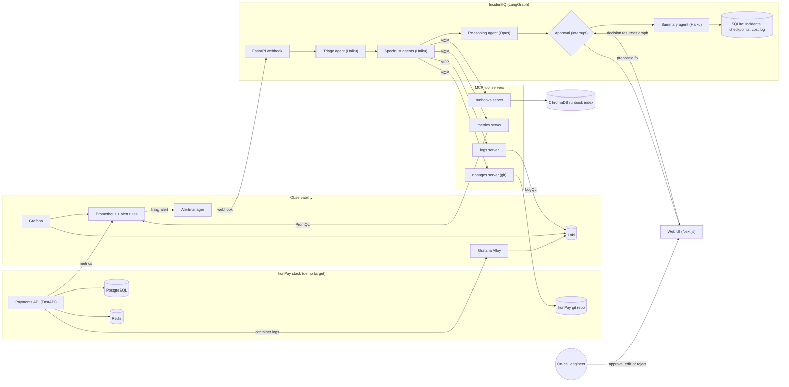

# IncidentIQ AgentOps

When an alert fires, a LangGraph team of LLM agents does the on-call engineer's first pass: it gathers evidence, ranks likely root causes with citations, and proposes a fix for a human to approve.

Status: in development — design spec and build plan; results land as each phase ships.

         

---

## Why this exists

An alert at 2 a.m. says "p95 latency on `/transfers` is above 800 ms". Before anyone can fix anything, the on-call engineer opens Grafana, runs a few PromQL queries, greps logs in Loki, checks what was deployed in the last hour, and searches the wiki for a runbook. That first pass is mostly the same every time, and it is slow when you have just been woken up. IncidentIQ automates it: it collects the same evidence through tools, ties every claim to a specific log line, metric or commit, and hands the engineer a short ranked list of causes and a proposed fix. The engineer still decides. Nothing changes in production without a human click.

## What it does

- **Starts from a real alert.** Prometheus alert rules fire through Alertmanager, which posts a webhook to IncidentIQ. One alert group becomes one incident.
- **Triage agent** reads the alert, extracts the service, symptom and time window, and picks which specialists to run.
- **Four specialist agents run in parallel** and pull evidence through MCP tool servers: logs from Loki (LogQL), metrics from Prometheus (PromQL), recent deploys and config changes from git, and matching runbooks through RAG over markdown runbooks in ChromaDB.
- **Reasoning agent** (`claude-opus-5-5`) ranks the top three root causes. Each hypothesis must cite evidence IDs, and the code rejects citations that do not exist.
- **Human-in-the-loop approval.** The graph pauses on a LangGraph `interrupt` before any action. The engineer approves, edits or rejects the proposed fix in the web UI, and the graph resumes from its checkpoint.
- **Post-incident summary** with a timeline, the confirmed cause, the fix and follow-up items, saved as markdown.
- **Eval harness** breaks IronPay in 15–20 scripted ways and scores IncidentIQ on each: root cause in top-1 and top-3, time to first hypothesis, tokens and USD per incident.
- **Cost controls built in**: cheap model for bulk steps, prompt caching on stable prompts, a per-incident and monthly budget cap, and a token and cost log for every LLM call.

## Architecture



IronPay runs with its normal dependencies, and the observability stack scrapes its metrics and ships its container logs to Loki. When an alert rule fires, Alertmanager posts to the IncidentIQ webhook, which starts one LangGraph run per incident and stores its state in a SQLite checkpointer. The triage agent decides which specialists to run. The specialists call read-only MCP tools that wrap Loki, Prometheus, the IronPay git history and the ChromaDB runbook index, and each returns a list of numbered evidence items. The reasoning agent turns that evidence into ranked, cited hypotheses and a proposed fix, then the graph pauses until an engineer decides in the web UI. After the decision, the summary agent writes the post-incident report.

## How it works

### Alert intake and triage

Prometheus evaluates alert rules for IronPay (5xx rate, p95 latency, target down, container restarts, consumer lag). Alertmanager groups related alerts and posts them to `POST /alerts`. The webhook uses the alert group fingerprint as the incident ID, so a repeated notification for the same group does not start a second investigation. The triage agent (`claude-haiku-5-5`) turns the raw payload into a typed `Triage` object: service, symptom, start time, a time window to search, and the list of specialists to run. Triage is a small, structured step on purpose: it is cheap, easy to test, and it keeps the rest of the graph from reading raw Alertmanager JSON.

### Specialist agents and MCP tool servers

Each specialist is a short Claude tool-use loop on `claude-haiku-5-5` with a step limit (6 tool calls by default). Its tools come from one MCP server, discovered at startup with `list_tools` and passed to Claude as tool definitions:

| MCP server | Example tools | Backend |
|---|---|---|
| logs | `search_logs`, `top_error_patterns` | Loki (LogQL) |
| metrics | `query_range`, `compare_to_baseline` | Prometheus (PromQL) |
| changes | `recent_commits`, `config_diff` | IronPay git clone |
| runbooks | `search_runbooks`, `get_runbook` | ChromaDB |

All tools are read-only. The servers summarize before they return: `top_error_patterns` groups log lines into patterns with counts instead of sending 5,000 raw lines, and `query_range` returns a downsampled series plus min, max and baseline. This keeps tokens per incident low and makes tool output easier for the model to read. Each specialist ends by writing evidence items with an ID (`E1`, `E2`...), the source, the exact query, the finding and a timestamp. The servers use MCP's streamable HTTP transport, so each runs in its own container and can also be used from Claude Desktop or Claude Code for manual debugging.

### Runbook RAG

The `runbooks/` folder holds 12–15 short markdown runbooks written for IronPay (for example "Postgres slow queries", "Redis unavailable", "API container OOMKilled"). A loader splits them by heading, stores each chunk with metadata (service, failure type, runbook path) in a persistent ChromaDB collection, and embeds them with Chroma's default local embedding model, so indexing costs nothing. The runbooks server searches with an optional `service` filter and returns the chunk plus its source path, so the reasoning agent can cite the runbook section it used.

### Root-cause reasoning

The reasoning agent runs on `claude-opus-5-5` and gets the triage result plus all evidence items. It returns structured output (validated with Pydantic): up to three hypotheses, each with a `cause_id` from a fixed taxonomy, a one-line explanation, a confidence, the evidence IDs it relies on, and a proposed fix with its runbook reference and risk level. Code checks every cited ID against the evidence list. If a hypothesis cites nothing or cites an unknown ID, the agent is asked once to fix it. If the evidence is too thin, the agent can request one more round of investigation, which loops back to the specialists a single time. The fixed `cause_id` taxonomy is what makes automatic scoring possible; an `other` value with free text covers causes outside it.

### Human approval

The approval node calls LangGraph's `interrupt()` with the ranked hypotheses and the proposed fix. The run's state is saved by the checkpointer and the process is free to do other work. The web UI shows the pending decision. When the engineer approves, edits or rejects, the API resumes the run with `Command(resume=decision)` on the same `thread_id`. In the core scope, "approve" records the decision and shows the exact command to run (for example `docker compose restart api`); IncidentIQ does not execute it. Auto-remediation is a stretch goal.

### Post-incident summary

After the decision, the summary agent (`claude-haiku-5-5`) writes a short blameless summary: what fired, the timeline of agent steps, the confirmed or rejected cause, the fix, and follow-up items. It is stored with the incident and shown in the UI.

### Incident scenarios

`incidents/catalog.yaml` will hold 15–20 scenarios. Each has an inject script, a reset script, the alert it should trigger, and the ground-truth `cause_id`. Planned examples:

| Scenario | Category | How it is injected | Ground-truth cause |
|---|---|---|---|
| `api-crash` | crashed container | kill the API container with restart disabled | `api_process_down` |
| `api-oom` | memory pressure | lower `mem_limit` and hit a memory-heavy endpoint | `api_oom_killed` |
| `db-missing-index` | slow query | drop the index on ledger entries by account | `db_missing_index` |
| `db-lock-contention` | slow query | hold a long transaction that locks hot rows | `db_lock_contention` |
| `db-pool-too-small` | bad config | set the DB pool size to 1 | `db_pool_exhausted` |
| `redis-down` | dependency down | stop the Redis container | `redis_unavailable` |
| `bad-redis-url` | bad config | deploy with a wrong `REDIS_URL` | `bad_config_redis_url` |
| `bad-deploy-threshold` | bad deploy | commit and deploy a fraud threshold that holds every transfer | `bad_deploy_logic_change` |

Every scenario's reset script returns the stack to a clean state, so the eval can run them one after another.

### Eval harness

`make eval` runs each scenario: reset, inject, wait for the alert, let IncidentIQ investigate, auto-approve in eval mode, and record the outcome. A scenario is correct at top-1 if the first hypothesis's `cause_id` equals the ground truth, and at top-3 if it appears in the first three. Each live run also saves an **evidence snapshot** (every MCP tool call and its response). Replay mode feeds those snapshots back instead of the live tools, so prompt changes to the reasoning step can be re-scored without breaking IronPay again and without paying for evidence gathering twice. Raw results go to `docs/results/` as JSON plus a markdown table.

### Models and cost

All LLM calls go through one small `incidentiq/llm/` module on the official `anthropic` SDK. It picks the model per node (`claude-haiku-5-5` for triage, specialists and summary; `claude-opus-5-5` for reasoning), sets effort explicitly per node, checks `stop_reason` (including `refusal` and `max_tokens`) before reading a response, and logs input, output and cache tokens plus USD for every call. Stable system prompts and tool definitions come first in each request and are marked for prompt caching. A per-incident cap stops an investigation that runs over budget, and a monthly cap (`LLM_MONTHLY_BUDGET_USD`) blocks new calls. Tests use a fake provider, so CI never needs a key or spends money.

### Web UI

A small Next.js + Tailwind app with three screens: the incident list, an incident page with the agent timeline (each step, its tool calls and evidence) and the approval panel, and an eval results table. It reads from the IncidentIQ API and polls while a run is active. The UI follows the unslop skill rules used across these projects: a 4px spacing grid, one neutral ramp plus one accent, lucide line icons, sentence-case copy and tabular numbers.

## Tech stack

| Layer | Tools | Why |
|---|---|---|
| Agent orchestration | LangGraph | Explicit graph with parallel branches, typed state, a checkpointer and `interrupt` for human approval |
| Tool protocol | MCP Python SDK (FastMCP), streamable HTTP | Tools live in separate, testable servers with a standard interface that any MCP client can use |
| LLMs | Claude via the `anthropic` SDK: `claude-haiku-5-5`, `claude-opus-5-5` | Cheap model for many small evidence calls, strong model for the one hard reasoning call |
| Retrieval | ChromaDB with the default local embedding model | Embedded vector store, no extra service, free embeddings for a small runbook set |
| Metrics and alerts | Prometheus, Alertmanager, cAdvisor, Postgres and Redis exporters | Standard open-source stack; alert rules give IncidentIQ real triggers |
| Logs | Loki, Grafana Alloy, Grafana | Label-indexed logs with LogQL; Grafana to check what IncidentIQ claims |
| API and state | FastAPI, SQLite | Webhook and UI API; SQLite holds incidents, LangGraph checkpoints and the cost log |
| UI | Next.js, Tailwind CSS, lucide-react | Small, typed UI for the timeline and approvals |
| Infra | Docker Compose, Makefile | One command brings up IronPay, observability and IncidentIQ |
| Quality | pytest, ruff, GitHub Actions | Unit and graph tests with a fake LLM on every push |

## Project structure

```
IncidentIQ-AgentOps/
├── incidentiq/
│   ├── api/              # FastAPI: alert webhook, incidents, approval resume
│   ├── graph/            # LangGraph state, nodes, edges, graph builder
│   │   └── nodes/        # triage, specialists, reasoner, approval, summary
│   ├── llm/              # anthropic client wrapper, model routing, cost log, fake provider
│   ├── mcp_client/       # MCP sessions, MCP tool -> Claude tool conversion
│   ├── prompts/          # system prompts (stable, cache-friendly)
│   └── store/            # SQLite incident store and checkpointer setup
├── mcp_servers/
│   ├── logs/             # Loki tools
│   ├── metrics/          # Prometheus tools
│   ├── changes/          # git tools
│   └── runbooks/         # ChromaDB search tools + loader
├── runbooks/             # markdown runbooks for IronPay
├── incidents/
│   ├── catalog.yaml      # scenarios + ground-truth cause_id
│   └── scenarios/        # inject and reset scripts
├── evals/                # harness, scoring, replay, snapshots/
├── ui/                   # Next.js + Tailwind app
├── infra/                # prometheus.yml, alert rules, alertmanager, loki, alloy, grafana
├── tests/
├── docs/
│   ├── results/          # raw eval output
│   └── screenshots/
├── docker-compose.yml
├── Makefile
├── requirements.txt
├── requirements-dev.txt
├── .env.example
└── .github/workflows/ci.yml
```

## Getting started

This is the target workflow once Phase 1 lands. None of it runs yet.

**Prerequisites**

- Docker Desktop with Compose v2.20 or later
- Python 3.11 and Node.js 20 (for running tests and the UI outside Docker)
- `make` (on Windows, use Git Bash or WSL, or run the `docker compose` commands from the Makefile directly)
- An Anthropic API key

**Setup**

```bash
# IncidentIQ expects IronPay as a sibling folder
git clone https://github.com/striderzz/IronPay-LedgerAPI.git
git clone https://github.com/striderzz/IncidentIQ-AgentOps.git
cd IncidentIQ-AgentOps

cp .env.example .env
# set ANTHROPIC_API_KEY, IRONPAY_DIR=../IronPay-LedgerAPI,
# LLM_MONTHLY_BUDGET_USD and INCIDENTIQ_MAX_USD_PER_INCIDENT

make up              # docker compose up -d: IronPay, observability, MCP servers, IncidentIQ API, UI
make index-runbooks  # load runbooks/ into ChromaDB
```

**Try one incident**

```bash
make incident SCENARIO=db-missing-index   # break IronPay on purpose
# open http://localhost:3000 and watch the timeline, then approve or reject
make reset SCENARIO=db-missing-index
```

Grafana is at http://localhost:3001 and Prometheus at http://localhost:9090.

**Tests and evals**

```bash
pip install -r requirements.txt -r requirements-dev.txt
make test                  # ruff + pytest, uses the fake LLM, no key needed
make eval                  # full live eval, spends API credits
make eval-replay           # re-score from saved evidence snapshots, reasoning step only
```

## Results

Nothing has been measured yet. Each value is filled in from a real run, and the raw output is committed to `docs/results/`.

| Metric | Value | How it is measured |
|---|---|---|
| Top-1 root-cause accuracy | — | Share of scenarios where hypothesis 1's `cause_id` equals the ground truth. Measured after Phase 8; raw output in docs/results/ |
| Top-3 root-cause accuracy | — | Share of scenarios where the ground truth is in the first three hypotheses. Measured after Phase 8; raw output in docs/results/ |
| Median time to first hypothesis | — | Seconds from webhook receipt to the stored reasoning output, across the incident set. Measured after Phase 8; raw output in docs/results/ |
| Tokens per incident | — | Sum of input, output and cache tokens from the cost log, median per incident. Measured after Phase 8; raw output in docs/results/ |
| USD per incident | — | Cost log totals at list price, median per incident. Measured after Phase 8; raw output in docs/results/ |
| Steps needing human correction | — | Share of agent steps a reviewer flagged in the UI as wrong or needing an edit. Measured after Phase 8; raw output in docs/results/ |

## Roadmap

- [ ] Phase 1: scaffold, Docker Compose with IronPay and the observability stack, alert rules, CI (ruff + pytest)
- [ ] Phase 2: LLM module on the `anthropic` SDK, model routing, token and cost log, budget caps, fake provider
- [ ] Phase 3: MCP servers for logs (Loki), metrics (Prometheus) and changes (git), with tests
- [ ] Phase 4: runbooks, ChromaDB loader and the runbooks MCP server
- [ ] Phase 5: LangGraph workflow: triage, parallel specialists, reasoning with citation checks, approval interrupt, summary
- [ ] Phase 6: FastAPI endpoints and the Next.js UI (timeline, approval, eval table), unslop pass, screenshots
- [ ] Phase 7: incident catalog with 15–20 scenarios, inject and reset scripts
- [ ] Phase 8: eval harness with live and replay modes, published results, demo GIF

## Stretch goals

- Slack or Teams notifications with an approve button that resumes the graph
- Auto-remediation for safe actions (restart a container, roll back to the previous image) only after approval, with an allowlist of commands
- OpenAI as an alternate provider through the official `openai` SDK, compared on the same incident set
- Tracing with Langfuse for per-step latency and cost views
- Run the reasoning step of replay evals through the Message Batches API at half price

## Related projects

- [IronPay LedgerAPI](https://github.com/striderzz/IronPay-LedgerAPI): the payments service IncidentIQ investigates; every eval scenario breaks it on purpose
- [CloudShip DevOps](https://github.com/striderzz/CloudShip-DevOps): deploys IronPay to AWS; a later target for pointing IncidentIQ at a cloud deployment
- [EvalForge LLMOps](https://github.com/striderzz/EvalForge-LLMOps): LLM evaluation methods that the scoring and replay ideas here build on

## Author

Hasan · [GitHub](https://github.com/striderzz) · [LinkedIn](https://www.linkedin.com/in/hasan-m-4b1bba315) · [Portfolio](https://striderzz.github.io/portfolio-website)

## License

MIT
