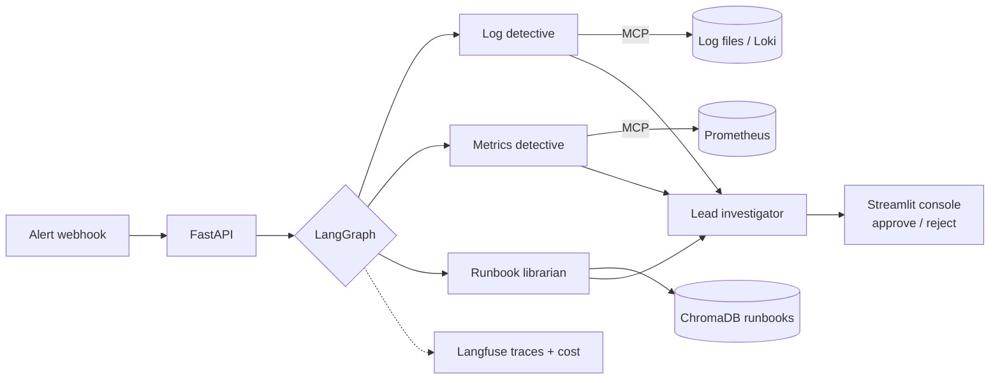

# Jarvis – Incident Agents

**An AI agent that investigates why a service broke: it reads logs, metrics and runbooks, names the likely cause, and suggests a fix for a human to approve**

LangGraph · Model Context Protocol (MCP) · ChromaDB · Langfuse · FastAPI · Streamlit · Docker · Claude API · OpenAI API · custom LLMs

> **Status: under active development.** This README is the design spec. The checklist in the [Roadmap](#roadmap) shows what is built so far.

---

## Overview

When an alert fires, an on-call engineer checks logs, metrics, recent changes and runbooks before finding the cause. Jarvis does that first pass automatically.

A small team of agents built in **LangGraph** collects evidence through **MCP tools**:

| Agent | What it does |
|---|---|
| **Log detective** | Searches logs for new errors and spikes around the alert time |
| **Metrics detective** | Checks error rate, latency and CPU/memory for the affected service |
| **Runbook librarian** | Finds the matching runbook with RAG (ChromaDB) |
| **Lead investigator** | Combines the evidence, ranks likely causes, and drafts a fix and a short incident report |

Nothing is changed automatically. The suggested fix appears in a Streamlit console for a person to approve or reject.

## Architecture



## How it is tested

A demo app (or [Ironbank](https://github.com/striderzz/ironbank-payments-ledger)) is broken on purpose in 15–20 ways: a crashed container, a slow database, a bad config value, memory pressure, a bad deploy. For each incident Jarvis is scored on:
- whether the true cause is its top answer (**top-1 accuracy**) or in its top three;
- time to answer and **cost per investigation** (from Langfuse).

## Results to publish (only from real runs)

| Metric | Value |
|---|---|
| Root-cause accuracy (top-1 / top-3) | from the incident set |
| Average time per investigation | Langfuse |
| Average cost per investigation | Langfuse |

## AI features

- **Claude tool use** drives the investigation. Each detective is a set of strict, schema-validated tools (log search, PromQL query, runbook search) exposed through **MCP**.
- **Two model tiers:** the lead investigator uses the main model with adaptive thinking for the final diagnosis. The detectives use a cheaper model (Haiku by default) for evidence gathering.
- **Prompt caching** on the long system prompt and runbook index keeps repeated investigations cheap.
- **Structured output** for the final report: ranked causes, evidence links, confidence, suggested fix, and the rollback command.
- **Evaluation at half cost:** the incident set runs through the **Message Batches API**, and the same set compares Claude, OpenAI and a custom model.

## LLM providers and API keys

Every AI feature goes through one small provider layer, so you can switch models without touching the rest of the code.

| Provider | How it is called | Used for |
|---|---|---|
| **Claude** (default) | Official `anthropic` Python SDK | Reasoning, tool use, structured outputs, vision, PDF citations |
| **OpenAI** | Official `openai` Python SDK | Alternative chat model, embeddings, speech-to-text |
| **Custom LLM** | Any OpenAI-compatible endpoint: base URL + API key + model name | Gemini, Groq, DeepSeek, OpenRouter, a local Ollama model, or anything else not listed |

**Setting keys:** use either option.
1. Copy `.env.example` to `.env` and fill in `ANTHROPIC_API_KEY`, `OPENAI_API_KEY`, or the `CUSTOM_LLM_*` values.
2. Or open the app's **Settings** page, paste keys, pick a provider and model per feature, and press **Test connection**. Keys are saved locally in a gitignored file, shown masked, and never logged.

**Staying within budget:**
- Each call's tokens and cost are logged.
- A monthly budget cap (set in Settings) stops AI calls once it is reached.
- Long, stable prompts use prompt caching.
- Offline evaluations run through the Message Batches API at half the price.
- Bulk steps can use a cheaper model, chosen per feature in Settings. The defaults are `claude-opus-5-5` for the main reasoning step and `claude-haiku-5-5` for bulk steps.

## Repository structure

```
jarvis-incident-agents/
├── requirements.txt
├── .env.example
├── jarvis/agents/      # LangGraph graph + agents
├── jarvis/mcp/         # MCP servers: logs, metrics
├── jarvis/rag/         # runbook loader + ChromaDB
├── incidents/          # break-it scripts + expected causes
├── evals/              # scoring script
├── console/            # Streamlit app
├── api/                # FastAPI webhook
└── docker-compose.yml
```

## Roadmap

- [ ] Provider layer (Claude, OpenAI, custom), Settings page, budget cap
- [ ] Demo service with Prometheus metrics and logs
- [ ] MCP servers for logs and metrics
- [ ] LangGraph agents + runbook RAG
- [ ] Streamlit approval console
- [ ] Incident set + accuracy evaluation
- [ ] AI features + provider comparison
- [ ] Langfuse tracing, screenshots, demo GIF

## Author

**Hasan Mohd Hussain**: [GitHub](https://github.com/striderzz) · [LinkedIn](https://www.linkedin.com/in/hasan-m-4b1bba315/) · [Portfolio](https://striderzz.github.io/portfolio-website/)
